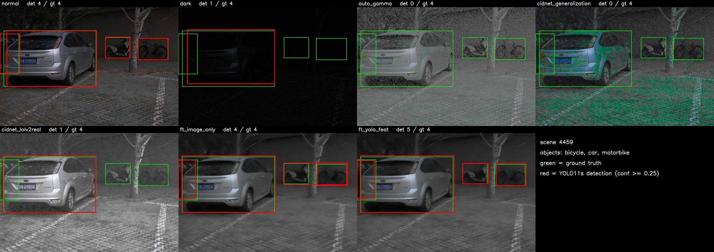
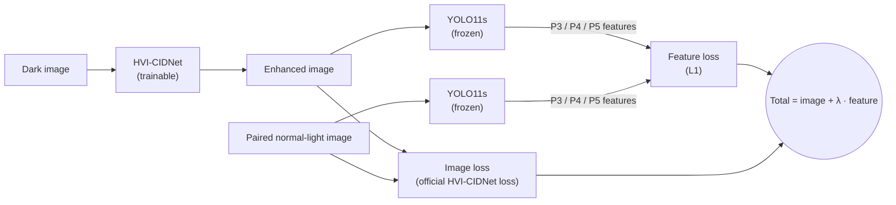

# Detection-Driven Low-Light Enhancement with a Frozen Detector

Course project for ENGR 501 (Deep and Reinforcement Learning for Engineers), UBC Okanagan.

[**Pretrained weights (Hugging Face)**](https://huggingface.co/BobRuan174/llie-frozen-detector) ·
[**Detailed experiment log (Chinese)**](docs/experiment_log_zh.md)

**In one sentence:** we fine-tune a low-light enhancement network (HVI-CIDNet) using a *frozen* object detector (YOLO11s)
as part of the loss, so that an existing daytime detector works better at night **without retraining the detector and
without any bounding boxes on dark images**.

**In numbers** (LIS test set, 669 image pairs, mAP50): the detector scores 0.719 on normal-light images and drops to
0.411 on dark ones. Off-the-shelf enhancement only reaches 0.466. Our enhancer reaches **0.625**, recovering about **70%**
of the lost accuracy.


<sub>LIS test scene 4459. Top: normal-light, dark, gamma, off-the-shelf CIDNet (generalization). Bottom: off-the-shelf
CIDNet (LOL-v2), fine-tuned with image loss only, fine-tuned with the frozen-YOLO loss (λ = 1). Green: ground truth;
red: YOLO11s detections.</sub>

## 1. The problem: looking better is not detecting better

Low-light enhancement networks are trained to make a dark image *look like* its normal-light version, and they are
scored with image metrics such as PSNR. A natural plan is to put one in front of a detector at night. We tried that on
LIS and found that it often makes detection **worse**:

| Input to the frozen YOLO11s | PSNR ↑ | mAP50 ↑ |
|---|---|---|
| Dark image, no enhancement | 13.73 | **0.411** |
| Dark + gamma correction | 15.24 | 0.219 |
| Dark + HVI-CIDNet, official `generalization.pth` | **17.52** | 0.355 |
| Dark + HVI-CIDNet, official `LOLv2_real/w_perc.pth` | 15.72 | 0.466 |

The method with the highest PSNR detects worse than doing nothing. A likely reason: LIS images are extremely dark (mean
brightness about 7/255), so brightening them also amplifies noise and shifts colours, and a detector trained on clean
daytime COCO images is sensitive to those artefacts. Either way, image quality and detection accuracy are different
targets.

## 2. The setting: keep the detector, change only the enhancer

We assume a practical constraint: a system already has one detector that works in daylight, and we do not want to
retrain or replace it for night-time. So:

- The detector is **COCO-pretrained YOLO11s, frozen**. Its weights are never updated, and the exact same file is used for
  evaluation.
- Only the enhancer (HVI-CIDNet) is trained.
- Training data is **pairs of dark and normal-light images of the same scene** (LIS is shot from a tripod with short and
  long exposure). No bounding boxes are used for training.

## 3. The idea: let the detector judge the enhancement

If the goal is "the detector should see the dark image the way it sees the daylight image", we can measure that
directly. We pass both the enhanced image and its paired normal-light image through the frozen detector and compare
the feature maps the detector actually uses to find objects. That distance is added to the usual image loss:



- **Image loss:** the official HVI-CIDNet loss (L1 + SSIM + edge + VGG perceptual, in both RGB and HVI space). It keeps
  the output looking like a natural image.
- **Feature loss:** mean L1 distance between the YOLO11s features at layers 16/19/22, i.e. the three maps (P3/P4/P5)
  that feed the detection head. Gradients flow *through* the frozen detector back into the enhancer.
- **Why features and not a detection loss:** a detection loss would need ground-truth boxes. Matching features only
  needs the normal-light image, which plays the role of the "answer key".
- **λ** sets the balance. λ = 0 is the control: the same fine-tuning with the image loss only.

The enhancer starts from the official `LOLv2_real/w_perc.pth` weights. Implementation:
[`scripts/train_lis.py`](scripts/train_lis.py).

## 4. Results

All numbers are on the official LIS test split (669 pairs, 8 classes), mAP50 at IoU 0.5, detector input size 1280.
PSNR/SSIM are measured against the paired normal-light image. Raw outputs behind every number are in [`logs/`](logs).

### Does it help?

| Input to the frozen YOLO11s | PSNR | SSIM | mAP50 | Recall |
|---|---|---|---|---|
| Normal-light image (upper bound) | – | – | 0.719 | 0.729 |
| Dark image (lower bound) | 13.73 | 0.142 | 0.411 | 0.399 |
| Dark + gamma correction | 15.24 | 0.278 | 0.219 | 0.202 |
| Dark + HVI-CIDNet, official `generalization.pth` | 17.52 | 0.306 | 0.355 | 0.324 |
| Dark + HVI-CIDNet, official `LOLv2_real/w_perc.pth` | 15.72 | 0.353 | 0.466 | 0.458 |
| Dark + fine-tuned, image loss only (λ = 0) | 21.45 | 0.525 | 0.594 | 0.581 |
| Dark + fine-tuned, λ = 1 | **21.50** | 0.524 | 0.616 | 0.602 |
| Dark + fine-tuned, λ = 10 (**ours**) | 21.45 | 0.517 | **0.625** | **0.614** |

Yes: 0.411 → 0.625, about 70% of the gap between dark and normal-light input.

### Where does the gain come from?

The improvement has two separate parts, and the λ = 0 control lets us tell them apart:

| Step | mAP50 | Gain | What it shows |
|---|---|---|---|
| Off-the-shelf CIDNet (`LOLv2_real/w_perc.pth`) | 0.466 | | |
| + fine-tune on LIS, image loss only (λ = 0) | 0.594 | +0.128 | adapting the enhancer to this kind of darkness and noise |
| + frozen-detector feature loss (λ = 10) | 0.625 | +0.031 | the contribution of this project's loss |

Most of the gain comes from fine-tuning on the target data at all. The detector loss then adds +0.031, which closes
about a quarter of the gap that image-only fine-tuning leaves. PSNR and SSIM barely change between λ = 0, 1 and 10, so
the extra detection accuracy is invisible to image metrics. This is the point of section 1 seen from the other side.

### Is the difference real or noise?

Paired bootstrap over the 669 test images (2,000 resamples), YOLO11s:

| Comparison | Δ mAP50 | 95% CI |
|---|---|---|
| λ = 1 vs. λ = 0 | +0.022 | [+0.016, +0.028] |
| λ = 10 vs. λ = 0 | +0.031 | [+0.021, +0.043] |
| λ = 10 vs. λ = 1 | +0.009 | [+0.002, +0.017] |
| λ = 0 vs. off-the-shelf CIDNet | +0.128 | [+0.101, +0.151] |

All intervals exclude zero. They cover test-set sampling only; each setting was trained once (see Limitations).

### Is the enhancer just overfitting to YOLO11s?

A worry with a detector-based loss is that the enhancer learns tricks that only fool that one network. We evaluated the
same enhanced images with two detectors that were **never used in training**, including a transformer-based one:

| Input | YOLO11s (used in training) | YOLOv8s | RT-DETR-L |
|---|---|---|---|
| Normal-light | 0.719 | 0.679 | 0.664 |
| Dark | 0.411 | 0.361 | 0.427 |
| Off-the-shelf CIDNet | 0.466 | 0.437 | 0.491 |
| Fine-tuned, λ = 0 | 0.594 | 0.534 | 0.545 |
| Fine-tuned, λ = 1 | 0.616 | 0.555 | 0.555 |
| Fine-tuned, λ = 10 | **0.625** | **0.572** | **0.572** |

The ranking is identical for all three detectors, and λ = 10 beats λ = 0 by +0.038 on YOLOv8s and +0.028 on RT-DETR-L.
The only non-significant difference is λ = 1 vs. λ = 0 on RT-DETR-L (95% CI [−0.001, +0.022]).

### How does it compare with a dedicated low-light detector?

YOLA (NeurIPS 2024) is a detector designed for low light. It is a different kind of method, since it changes the
detector, so the table states what each method is allowed to use:

| Method | Detector | Detector trained on LIS | Needs LIS boxes | mAP50 |
|---|---|---|---|---|
| Ours (λ = 10) | YOLO11s, frozen | No | No | 0.625 (7 classes: 0.628) |
| YOLA, official ExDark weights, input 608 | TOOD | No | No | 7 classes: 0.553 |
| YOLA, official ExDark weights, input 1280 | TOOD | No | No | 7 classes: 0.570 |
| YOLA, official ExDark weights | YOLOv3 | No | No | 7 classes: 0.509 |
| YOLA fine-tuned on LIS | TOOD | Yes | Yes | **0.719** |

- Under the same conditions (no detector retraining, no boxes), ours is better than YOLA's official weights.
- When YOLA is retrained on LIS with box labels it is better (0.719). Ours reaches about 87% of that while keeping the
  original detector and using no labels.
- ExDark has no `tvmonitor` class, so the official YOLA weights are compared on the 7 shared classes. YOLA was fine-tuned
  on LIS with its official config, changing only the dataset, the number of classes (12 → 8) and the batch size (4 → 2,
  to fit 6 GB of GPU memory).

## 5. Limitations

- **One run per setting.** The confidence intervals cover test-set sampling, not training randomness (different seeds).
- **λ was chosen by looking at test results.** Only 0, 1 and 10 were tried; a held-out validation split would be the
  stricter protocol.
- **One dataset.** LIS contains mostly static indoor and outdoor scenes. We have not shown the result on other data.
- **Needs paired data.** The feature loss needs a normal-light image of the same scene, which is easy with a tripod but
  not available for every application.

## 6. How the project got here

1. **Reproduced HVI-CIDNet** on LOL-v2-Real. The official weights match the official numbers to within 0.001 dB PSNR
   (table below), so the starting point is trustworthy.
2. **Tried off-the-shelf enhancement + detection on night-driving data** (DarkDriving, BDD100K samples). Enhancement made
   detection worse there too, but those datasets were a poor fit: cars are tiny, oncoming headlights wash out whole
   vehicles, and BDD100K's day and night images are not paired, so the feature loss could not be used.
3. **Moved to LIS**, which has pixel-aligned dark/normal pairs and box labels for evaluation, and confirmed the problem on
   the full test set (section 1).
4. **Trained with the frozen-detector loss**, then checked significance, other detectors, and a dedicated low-light
   detector (section 4).

Details and the abandoned directions are in the [experiment log](docs/experiment_log_zh.md).

### Reproduction of HVI-CIDNet

| Weights | GT-mean | Official PSNR / SSIM / LPIPS | Ours |
|---|---|---|---|
| `LOLv2_real/w_perc.pth` | yes | 28.1387 / 0.8920 / 0.1008 | 28.1397 / 0.8920 / 0.1007 |
| `LOLv2_real/best_PSNR.pth` | no | 23.9040 / 0.8656 / 0.1219 | 23.9044 / 0.8656 / 0.1219 |
| `LOLv2_real/best_SSIM.pth` | no | 23.8975 / 0.8705 / 0.1185 | 23.8975 / 0.8705 / 0.1185 |

## Installation

Two conda environments: `cidnet` for everything in the main pipeline, and `yola` (adds MMDetection 3.3) for the YOLA
baseline. Tested with Python 3.8, PyTorch 2.0.1 and CUDA 11.8.

```bash
git clone --recurse-submodules https://github.com/BobRuan/llie-frozen-detector.git
cd llie-frozen-detector
bash envs/setup_envs.sh          # Linux; creates both environments
```

On Windows, follow the commands at the top of [`envs/requirements-cidnet.txt`](envs/requirements-cidnet.txt) and
[`envs/requirements-yola.txt`](envs/requirements-yola.txt). If you cloned without `--recurse-submodules`, run
`git submodule update --init`.

## Data and pretrained weights

```bash
conda activate cidnet
python scripts/download_all.py           # official weights, our weights, detectors, LIS (~4.4 GB), LOL-v2 (~1 GB)
python scripts/download_all.py --yola    # additionally, YOLA weights (official and fine-tuned on LIS)
```

| What | Source |
|---|---|
| Our fine-tuned HVI-CIDNet (λ = 0 / 1 / 10) | [BobRuan174/llie-frozen-detector](https://huggingface.co/BobRuan174/llie-frozen-detector) |
| Official HVI-CIDNet weights | [Fediory/HVI-CIDNet](https://huggingface.co/Fediory/HVI-CIDNet), checked against recorded SHA256 |
| YOLO11s, YOLOv8s, RT-DETR-L | Ultralytics releases (COCO-pretrained) |
| YOLA official weights | [MingboHong/YOLA](https://github.com/MingboHong/YOLA) Google Drive links |
| YOLA fine-tuned on LIS | [BobRuan174/llie-yola-lis](https://huggingface.co/BobRuan174/llie-yola-lis), or reproduce with `scripts/train_yola_lis.py` |
| LIS | [Linwei-Chen/LIS](https://github.com/Linwei-Chen/LIS) |
| LOL-v2 | Google Drive mirror provided by Retinexformer |

The class names in the official LIS annotation file are in the wrong order; the scripts correct them (`NAME_FIX` in
[`scripts/run_pipeline_lis.py`](scripts/run_pipeline_lis.py)), verified with [`scripts/check_lis_classes.py`](scripts/check_lis_classes.py).

## Usage

**Evaluate the pretrained weights** (reproduces the tables in section 4):

```bash
python scripts/run_pipeline_lis.py --data data/LIS/test --out outputs/lis_test \
    --weights ft_image_only=weights/lis_ft/image_only/epoch_050.pth \
              ft_yolo_feat=weights/lis_ft/yolo_feat/epoch_050.pth \
              ft_yolo_feat_w10=weights/lis_ft/yolo_feat_w10/epoch_050.pth
python scripts/eval_lis_robustness.py
```

**Train** (about 3 hours per run on a 6 GB RTX 3060 Laptop GPU):

```bash
python scripts/train_lis.py --name image_only    --yolo_weight 0
python scripts/train_lis.py --name yolo_feat     --yolo_weight 1
python scripts/train_lis.py --name yolo_feat_w10 --yolo_weight 10
```

Add `--resume` to continue an interrupted run. Settings: batch size 2, crop 256, Adam, learning rate 1e-4 with cosine
decay to 1e-6, 50 epochs, seed 0. The final epoch is used; no checkpoint was selected on the test set.

**Reproduce HVI-CIDNet on LOL-v2-Real:** `python scripts/reproduce_lolv2_real.py`

**YOLA baseline** (in the `yola` environment):

```bash
python scripts/run_yola_lis.py --checkpoint weights/yola/tood_exdark/753.pth
python scripts/train_yola_lis.py --batch 2
python scripts/run_yola_lis.py --config scripts/yola_configs/tood_yola_lis.py \
    --checkpoint weights/yola_lis_ft/tood_lis/epoch_24.pth
```

**Enhance your own images:**
`python scripts/infer_folder.py --input <folder> --output <folder> --weight weights/lis_ft/yolo_feat_w10/epoch_050.pth`

## Repository structure

```
code/HVI-CIDNet/      official HVI-CIDNet (git submodule, unmodified)
code/YOLA/            official YOLA (git submodule, unmodified)
scripts/              all project code: training, evaluation, data download, figures
scripts/yola_configs/ YOLA config for LIS (inherits the official ExDark config)
envs/                 environment files and setup script
logs/                 raw logs and result JSON files behind every number in this README
docs/                 figures and the detailed experiment log
data/ weights/ outputs/   created by the scripts, not tracked
```

## Acknowledgements

This project builds on the following work; please cite the original papers if you use this code.

- HVI-CIDNet — *HVI: A New Color Space for Low-light Image Enhancement*, CVPR 2025. [code](https://github.com/Fediory/HVI-CIDNet) (MIT License)
- LIS — Chen et al., *Instance Segmentation in the Dark*, IJCV 2023. [dataset](https://github.com/Linwei-Chen/LIS)
- YOLA — Hong et al., *You Only Look Around: Learning Illumination-Invariant Feature for Low-light Object Detection*, NeurIPS 2024. [code](https://github.com/MingboHong/YOLA)
- [Ultralytics](https://github.com/ultralytics/ultralytics) (YOLO11, YOLOv8, RT-DETR) and [MMDetection](https://github.com/open-mmlab/mmdetection)

## License

The code in this repository is released under the [MIT License](LICENSE). Submodules, datasets and third-party weights
keep their own licenses.
