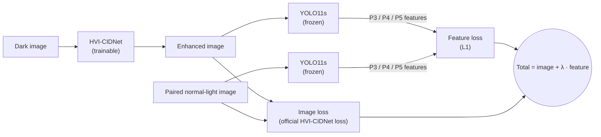

# Detection-Driven Low-Light Enhancement with a Frozen Detector

Fine-tuning the low-light enhancer **HVI-CIDNet** with a loss computed by a **frozen YOLO detector**, so that one
daytime detector works better in the dark **without retraining the detector and without box annotations on dark images**.

Course project for ENGR 501 (Deep and Reinforcement Learning for Engineers), UBC Okanagan.

[**Pretrained weights (Hugging Face)**](https://huggingface.co/BobRuan174/llie-frozen-detector) ·
[**Detailed experiment log (Chinese)**](docs/experiment_log_zh.md)


<sub>LIS test scene 4459. Top: normal-light, dark, gamma, off-the-shelf CIDNet (generalization). Bottom: off-the-shelf
CIDNet (LOL-v2), fine-tuned with image loss only, fine-tuned with the frozen-YOLO loss (λ = 1). Green: ground truth;
red: YOLO11s detections.</sub>

## Overview

Low-light enhancement networks are usually trained to make images *look* like their normal-light counterparts, which
does not guarantee that a detector can *recognize* objects in them. On the LIS dataset we found that off-the-shelf
enhancement often hurts detection: the variant with the highest PSNR detects worse than the raw dark image.

We keep the detector (COCO-pretrained YOLO11s) frozen and fine-tune only the enhancer. Besides the official image loss,
the enhanced image and its paired normal-light image are both passed through the frozen detector, and the L1 distance
between their neck features (the P3/P4/P5 maps that feed the detection head) is added to the loss. Training needs
paired dark/normal images but no bounding boxes.

**Key results on the LIS test set (669 pairs, frozen YOLO11s, mAP50 over 8 classes):**

- Dark input **0.411** → ours **0.625**, closing about **70%** of the gap to normal-light input (0.719).
- The detector-feature loss adds **+0.031** mAP50 over fine-tuning with the image loss alone (95% CI [+0.021, +0.043]).
- The gain transfers to detectors never used in training (YOLOv8s **+0.038**, RT-DETR-L **+0.028**).
- Ours beats the official weights of the low-light detector YOLA (NeurIPS 2024); YOLA retrained on LIS with box labels
  is better (0.719), and ours reaches about 87% of it without labels or detector retraining.

## Method



- **Enhancer:** HVI-CIDNet initialized from the official `LOLv2_real/w_perc.pth`.
- **Image loss:** the official HVI-CIDNet loss (L1 + SSIM + edge + VGG perceptual, in both RGB and HVI space).
- **Feature loss:** mean L1 distance between the frozen YOLO11s features at layers 16/19/22 (the inputs of the
  detection head) for the enhanced image and the normal-light image. Gradients flow through the detector into the
  enhancer; the detector's parameters are never updated.
- **Evaluation:** the original COCO-pretrained detector, unchanged, on enhanced test images.

Implementation: [`scripts/train_lis.py`](scripts/train_lis.py).

## Results

All numbers are on the official LIS test split (669 pairs), mAP50 over 8 classes at IoU 0.5, detector input size 1280.
PSNR/SSIM are measured against the paired normal-light image. Raw outputs are in [`logs/`](logs).

### Main results (frozen YOLO11s)

| Input to the detector | PSNR | SSIM | mAP50 | Recall |
|---|---|---|---|---|
| Normal-light image (upper bound) | – | – | 0.719 | 0.729 |
| Dark image (lower bound) | 13.73 | 0.142 | 0.411 | 0.399 |
| Dark + gamma correction | 15.24 | 0.278 | 0.219 | 0.202 |
| Dark + HVI-CIDNet, official `generalization.pth` | 17.52 | 0.306 | 0.355 | 0.324 |
| Dark + HVI-CIDNet, official `LOLv2_real/w_perc.pth` | 15.72 | 0.353 | 0.466 | 0.458 |
| Dark + fine-tuned, image loss only (λ = 0) | 21.45 | 0.525 | 0.594 | 0.581 |
| Dark + fine-tuned, λ = 1 | **21.50** | 0.524 | 0.616 | 0.602 |
| Dark + fine-tuned, λ = 10 (**ours**) | 21.45 | 0.517 | **0.625** | **0.614** |

### Robustness

Paired bootstrap over the 669 test images (2,000 resamples), YOLO11s:

| Comparison | Δ mAP50 | 95% CI |
|---|---|---|
| λ = 1 vs. λ = 0 | +0.022 | [+0.016, +0.028] |
| λ = 10 vs. λ = 0 | +0.031 | [+0.021, +0.043] |
| λ = 10 vs. λ = 1 | +0.009 | [+0.002, +0.017] |
| λ = 0 vs. off-the-shelf CIDNet | +0.128 | [+0.101, +0.151] |

Same enhanced images, evaluated with detectors that were **not** used during training:

| Input | YOLO11s (used in training) | YOLOv8s | RT-DETR-L |
|---|---|---|---|
| Normal-light | 0.719 | 0.679 | 0.664 |
| Dark | 0.411 | 0.361 | 0.427 |
| Off-the-shelf CIDNet | 0.466 | 0.437 | 0.491 |
| Fine-tuned, λ = 0 | 0.594 | 0.534 | 0.545 |
| Fine-tuned, λ = 1 | 0.616 | 0.555 | 0.555 |
| Fine-tuned, λ = 10 | **0.625** | **0.572** | **0.572** |

The ranking is identical for all three detectors. The only non-significant difference is λ = 1 vs. λ = 0 on RT-DETR-L
(95% CI [−0.001, +0.022]).

### Comparison with a dedicated low-light detector (YOLA, NeurIPS 2024)

| Method | Detector | Detector trained on LIS | Needs LIS boxes | mAP50 |
|---|---|---|---|---|
| Ours (λ = 10) | YOLO11s, frozen | No | No | 0.625 (7 classes: 0.628) |
| YOLA, official ExDark weights, input 608 | TOOD | No | No | 7 classes: 0.553 |
| YOLA, official ExDark weights, input 1280 | TOOD | No | No | 7 classes: 0.570 |
| YOLA, official ExDark weights | YOLOv3 | No | No | 7 classes: 0.509 |
| YOLA fine-tuned on LIS | TOOD | Yes | Yes | **0.719** |

ExDark has no `tvmonitor` class, so the official YOLA weights are compared on the 7 shared classes. YOLA was fine-tuned
on LIS with its official config, changing only the dataset, the number of classes (12 → 8) and the batch size (4 → 2,
to fit 6 GB of GPU memory).

### Reproduction of HVI-CIDNet

The official weights reproduce the official LOL-v2-Real numbers to within 0.001 dB PSNR:

| Weights | GT-mean | Official PSNR / SSIM / LPIPS | Ours |
|---|---|---|---|
| `LOLv2_real/w_perc.pth` | yes | 28.1387 / 0.8920 / 0.1008 | 28.1397 / 0.8920 / 0.1007 |
| `LOLv2_real/best_PSNR.pth` | no | 23.9040 / 0.8656 / 0.1219 | 23.9044 / 0.8656 / 0.1219 |
| `LOLv2_real/best_SSIM.pth` | no | 23.8975 / 0.8705 / 0.1185 | 23.8975 / 0.8705 / 0.1185 |

## Installation

Two conda environments: `cidnet` for everything in the main pipeline, and `yola` (adds MMDetection 3.3) for the YOLA
baseline. Tested with Python 3.8, PyTorch 2.0.1 and CUDA 11.8.

```bash
git clone --recurse-submodules https://github.com/BobRuan/llie-frozen-detector.git
cd llie-frozen-detector
bash envs/setup_envs.sh          # Linux; creates both environments
```

On Windows, follow the commands at the top of [`envs/requirements-cidnet.txt`](envs/requirements-cidnet.txt) and
[`envs/requirements-yola.txt`](envs/requirements-yola.txt). If you cloned without `--recurse-submodules`, run
`git submodule update --init`.

## Data and pretrained weights

```bash
conda activate cidnet
python scripts/download_all.py           # official weights, our weights, detectors, LIS (~4.4 GB), LOL-v2 (~1 GB)
python scripts/download_all.py --yola    # additionally, YOLA weights (needs `huggingface-cli login`)
```

| What | Source |
|---|---|
| Our fine-tuned HVI-CIDNet (λ = 0 / 1 / 10) | [BobRuan174/llie-frozen-detector](https://huggingface.co/BobRuan174/llie-frozen-detector) |
| Official HVI-CIDNet weights | [Fediory/HVI-CIDNet](https://huggingface.co/Fediory/HVI-CIDNet), checked against recorded SHA256 |
| YOLO11s, YOLOv8s, RT-DETR-L | Ultralytics releases (COCO-pretrained) |
| YOLA official weights | [MingboHong/YOLA](https://github.com/MingboHong/YOLA) Google Drive links |
| YOLA fine-tuned on LIS | private Hugging Face repo (YOLA has no license); reproduce with `scripts/train_yola_lis.py` |
| LIS | [Linwei-Chen/LIS](https://github.com/Linwei-Chen/LIS) |
| LOL-v2 | Google Drive mirror provided by Retinexformer |

The class names in the official LIS annotation file are in the wrong order; the scripts correct them (`NAME_FIX` in
[`scripts/run_pipeline_lis.py`](scripts/run_pipeline_lis.py)), verified with [`scripts/check_lis_classes.py`](scripts/check_lis_classes.py).

## Usage

**Evaluate the pretrained weights** (reproduces the main and robustness tables):

```bash
python scripts/run_pipeline_lis.py --data data/LIS/test --out outputs/lis_test \
    --weights ft_image_only=weights/lis_ft/image_only/epoch_050.pth \
              ft_yolo_feat=weights/lis_ft/yolo_feat/epoch_050.pth \
              ft_yolo_feat_w10=weights/lis_ft/yolo_feat_w10/epoch_050.pth
python scripts/eval_lis_robustness.py
```

**Train** (about 3 hours per run on a 6 GB RTX 3060 Laptop GPU):

```bash
python scripts/train_lis.py --name image_only    --yolo_weight 0
python scripts/train_lis.py --name yolo_feat     --yolo_weight 1
python scripts/train_lis.py --name yolo_feat_w10 --yolo_weight 10
```

Add `--resume` to continue an interrupted run.

**Reproduce HVI-CIDNet on LOL-v2-Real:** `python scripts/reproduce_lolv2_real.py`

**YOLA baseline** (in the `yola` environment):

```bash
python scripts/run_yola_lis.py --checkpoint weights/yola/tood_exdark/753.pth
python scripts/train_yola_lis.py --batch 2
python scripts/run_yola_lis.py --config scripts/yola_configs/tood_yola_lis.py \
    --checkpoint weights/yola_lis_ft/tood_lis/epoch_24.pth
```

**Enhance your own images:**
`python scripts/infer_folder.py --input <folder> --output <folder> --weight weights/lis_ft/yolo_feat_w10/epoch_050.pth`

## Repository structure

```
code/HVI-CIDNet/      official HVI-CIDNet (git submodule, unmodified)
code/YOLA/            official YOLA (git submodule, unmodified)
scripts/              all project code: training, evaluation, data download, figures
scripts/yola_configs/ YOLA config for LIS (inherits the official ExDark config)
envs/                 environment files and setup script
logs/                 raw logs and result JSON files behind every number in this README
docs/                 figures and the detailed experiment log
data/ weights/ outputs/   created by the scripts, not tracked
```

## Reproducibility notes

- **Hardware:** RTX 3060 Laptop (6 GB). Training uses batch size 2, crop 256, Adam, learning rate 1e-4 with cosine
  decay to 1e-6, 50 epochs, seed 0. The final epoch is used; no checkpoint was selected on the test set.
- **Single run per setting:** the confidence intervals above cover test-set sampling only, not training randomness.
- **λ was chosen by looking at test results** (only 0, 1 and 10 were tried); a held-out validation split would be the
  stricter protocol.
- **Single dataset:** LIS contains mostly static indoor/outdoor scenes. Early experiments on night-driving data
  (DarkDriving, BDD100K) are documented in the [experiment log](docs/experiment_log_zh.md).

## Acknowledgements

This project builds on the following work; please cite the original papers if you use this code.

- HVI-CIDNet — *HVI: A New Color Space for Low-light Image Enhancement*, CVPR 2025. [code](https://github.com/Fediory/HVI-CIDNet) (MIT License)
- LIS — Chen et al., *Instance Segmentation in the Dark*, IJCV 2023. [dataset](https://github.com/Linwei-Chen/LIS)
- YOLA — Hong et al., *You Only Look Around: Learning Illumination-Invariant Feature for Low-light Object Detection*, NeurIPS 2024. [code](https://github.com/MingboHong/YOLA)
- [Ultralytics](https://github.com/ultralytics/ultralytics) (YOLO11, YOLOv8, RT-DETR) and [MMDetection](https://github.com/open-mmlab/mmdetection)

## License

The code in this repository is released under the [MIT License](LICENSE). Submodules, datasets and third-party weights
keep their own licenses.
