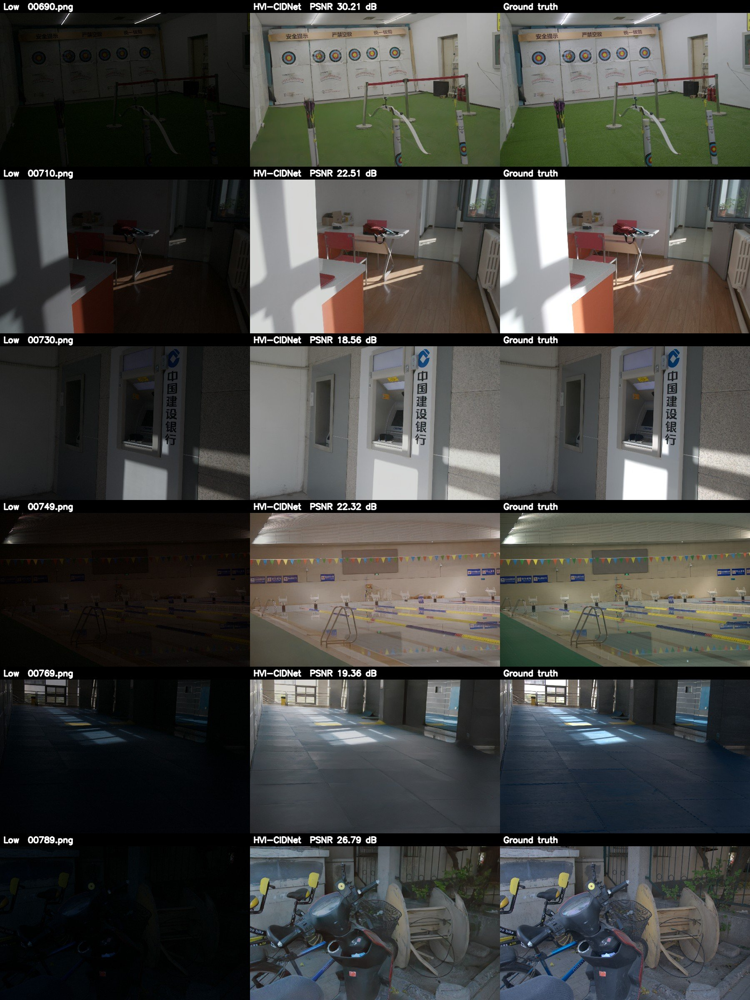

# 实验记录（中文）

按时间顺序记录的完整实验过程，包括探索阶段放弃的方向。项目概览见仓库根目录的 [README](../README.md)。


ENGR 501 课程项目：暗光增强 + 冻结检测器。复现低光增强模型 HVI-CIDNet（CVPR 2025），再把冻结的 YOLO
检测器当作损失来微调它，让同一个检测器不重新训练、也不需要暗光图的框标注，就能在暗光下检测得更好。

| 阶段 | 内容 | 章节 |
|---|---|---|
| 1 | 复现 HVI-CIDNet，结果和官方一致 | [复现结论](#复现结论) |
| 2 | 现成增强 + 检测：在 DarkDriving、BDD100K、LIS 上试跑 | [试跑](#10-对样本的完整管线试跑) |
| 3 | 用冻结 YOLO 的特征当损失微调 CIDNet（本项目的方法） | [第三阶段](#第三阶段用冻结-yolo-当损失微调增强网络) |
| 4 | 和夜间专用检测器 YOLA 对比，稳健性检查 | [对比方法](#对比方法yolaneurips-2024) |

## 在新机器上运行

代码在 GitHub，我们训练的权重在 Hugging Face，数据和官方权重从原始来源下载。clone 之后一条命令全部下好：

| 内容 | 放在哪 |
|---|---|
| 我们微调的 CIDNet（`weights/lis_ft/*/epoch_050.pth`） | Hugging Face 公开仓库 `BobRuan174/llie-frozen-detector` |
| YOLA 在 LIS 上微调的权重（`weights/yola_lis_ft/tood_lis/epoch_24.pth`） | Hugging Face 私有仓库（YOLA 没有许可证，不公开发布）；也可以用下面的命令重训 |
| LIS、LOL-v2、HVI-CIDNet 官方权重、检测器、YOLA 官方权重 | 各自的原始来源 |

```bash
git clone --recurse-submodules https://github.com/BobRuan/llie-frozen-detector.git
cd llie-frozen-detector
bash envs/setup_envs.sh                  # 建 conda 环境 cidnet 和 yola（Linux；Windows 见下）
conda activate cidnet
python scripts/download_all.py           # 官方权重、我们的权重、检测器、LIS（约 4.4 GB）、LOL-v2（约 1 GB）
python scripts/download_all.py --yola    # 需要做 YOLA 对比时再下（约 1 GB；私有仓库要先 huggingface-cli login）
```

- `code/HVI-CIDNet` 和 `code/YOLA` 是 git 子模块，固定在开发时用的提交上。clone 时忘了 `--recurse-submodules` 的话，补一句 `git submodule update --init`。
- 官方代码需要的目录链接（`code/HVI-CIDNet/{datasets,weights,output}`、`code/YOLA/_base_`）由脚本在第一次运行时自动创建：Windows 上是目录联接，Linux 上是符号链接。
- Windows 上没有 bash：按 `envs/requirements-cidnet.txt` 和 `envs/requirements-yola.txt` 顶部的命令手动装。
- 显卡要求：训练时 batch size 2、裁剪 256 需要约 5 GB 显存；更大的显卡可以把 `--batch` 调大。

主线实验的复现顺序（都在 `cidnet` 环境里，除非注明）：

```bash
python scripts/reproduce_lolv2_real.py                            # 阶段 1：复现官方结果，约 2 分钟
python scripts/run_pipeline_lis.py --data data/LIS/test --out outputs/lis_test   # 现成方法的基线
python scripts/train_lis.py --name image_only --yolo_weight 0     # 对照组，6 GB 显卡约 3 小时
python scripts/train_lis.py --name yolo_feat --yolo_weight 1
python scripts/train_lis.py --name yolo_feat_w10 --yolo_weight 10
python scripts/run_pipeline_lis.py --data data/LIS/test --out outputs/lis_test --only_extra --reuse \
  --weights ft_image_only=weights/lis_ft/image_only/epoch_050.pth \
            ft_yolo_feat=weights/lis_ft/yolo_feat/epoch_050.pth \
            ft_yolo_feat_w10=weights/lis_ft/yolo_feat_w10/epoch_050.pth
python scripts/eval_lis_robustness.py                             # 换检测器 + 自助抽样置信区间
```

不想重新训练的话，`download_all.py` 已经从 Hugging Face 下好了我们的权重，直接跑最后两步即可。

对比方法 YOLA（`yola` 环境）：

```bash
python scripts/run_yola_lis.py --checkpoint weights/yola/tood_exdark/753.pth           # 官方权重，不训练
python scripts/train_yola_lis.py --batch 2                                              # 在 LIS 上微调，6 GB 显卡约 1.3 小时
python scripts/run_yola_lis.py --config scripts/yola_configs/tood_yola_lis.py \
  --checkpoint weights/yola_lis_ft/tood_lis/epoch_24.pth                                # 微调后的权重（上一步生成，或 download_all.py --yola 下载）
```

## 复现结论

官方权重在 LOL-v2-Real 测试集（100 张）上的结果和官方 README 报告值一致，PSNR 差距不超过 0.001 dB，复现成功。

| 权重 | GT 均值校正 | 官方 README：PSNR / SSIM / LPIPS | 我们：PSNR / SSIM / LPIPS | ΔPSNR |
|---|---|---|---|---|
| `LOLv2_real/w_perc.pth`（best GT mean，alpha=0.84） | 是 | 28.1387 / 0.8920 / 0.1008 | 28.1397 / 0.8920 / 0.1007 | +0.0010 |
| 同上 | 否 | 未报告 | 23.2262 / 0.8637 / 0.1075 | – |
| `LOLv2_real/best_PSNR.pth`（alpha=0.80） | 否 | 23.9040 / 0.8656 / 0.1219 | 23.9044 / 0.8656 / 0.1219 | +0.0004 |
| 同上 | 是 | 未报告 | 27.9748 / 0.8829 / 0.1154 | – |
| `LOLv2_real/best_SSIM.pth`（alpha=0.82） | 否 | 23.8975 / 0.8705 / 0.1185 | 23.8975 / 0.8705 / 0.1185 | 0.0000 |
| 同上 | 是 | 28.3926 / 0.8873 / 0.1136 | 28.3926 / 0.8873 / 0.1136 | 0.0000 |

说明：

- 推理用官方 `eval.py`，指标用官方 `measure.py`，官方代码没有改动。
- “GT 均值校正”指评测时用 GT 的平均亮度把输出整体缩放一次（`measure.py --use_GT_mean`），会让 PSNR 高约 4 dB。写报告时要注明用的是哪种设置。
- 官方 README 里不用 GT 均值的最高值是 24.1106 dB（“v2 best Normal”），但官方标注该权重已丢失（lost），所以无法复现这一行。现有权重里不用 GT 均值最高的是 `best_PSNR.pth` 的 23.90 dB。
- 对比的是官方仓库 README 的数值，没有逐项核对论文 PDF 里的表格。
- 原始输出见 `logs\repro_lolv2_real.log` 和 `logs\repro_lolv2_real_results.json`。

视觉对比图（低光 | 增强 | GT），6 张测试图肉眼正常，没有明显色偏或伪影：



## 目录

```
llie_driving/
  code/HVI-CIDNet/     官方仓库，git 子模块（commit eb43d7d，未修改）
  code/YOLA/           对比方法的官方仓库，git 子模块（commit fe4f8c3，未修改）
  scripts/             本项目的脚本
  scripts/yola_configs/  YOLA 在 LIS 上微调的配置（继承官方配置，只改数据集和类别数）
  envs/                两个 conda 环境的依赖和一键安装脚本
  docs/figures/        README 用的图
  logs/                运行日志和结果 json（论文里的数字都能在这里找到出处）
  weights/             权重，由 download_all.py 下载，不进仓库（我们训练的在 Hugging Face）
  data/                数据集，由 download_all.py 下载，不进仓库
  outputs/             增强结果和对比图，由脚本生成，不进仓库
```

`code/HVI-CIDNet/` 下的 `datasets`、`weights`、`output` 是目录链接，分别指向
`data/`、`weights/`、`outputs/official_eval/`，这样官方脚本的相对路径不用改。

## 环境

两个 conda 环境，安装方法见 `envs/`：

- `cidnet`：主线实验（复现、增强网络训练、YOLO 检测评测）。下表是它的版本。
- `yola`：对比方法 YOLA，在 `cidnet` 基础上加 mmengine 0.10.4、mmcv 2.1.0、mmdet 3.3.0。

开发机是 Windows，环境在 `E:\Anaconda\envs\` 下。

| 包 | 版本 |
|---|---|
| Python | 3.8.20 |
| torch | 2.0.1+cu118 |
| torchvision | 0.15.2+cu118 |
| numpy | 1.24.4 |
| opencv-python | 4.7.0.72 |
| pillow | 10.4.0 |
| scipy | 1.10.1 |
| lpips | 0.1.4 |
| einops | 0.6.1 |
| huggingface_hub | 0.36.2 |

官方要求的是 Python 3.7 + torch 1.13.1，这里换成了较新的版本，结果不受影响（见上表）。
完整列表在 `logs\env_versions.txt`。

重建环境：

```powershell
E:\Anaconda\Scripts\conda.exe create -y -n cidnet python=3.8
E:\Anaconda\envs\cidnet\python.exe -m pip install torch==2.0.1 torchvision==0.15.2 --index-url https://download.pytorch.org/whl/cu118
E:\Anaconda\envs\cidnet\python.exe -m pip install lpips==0.1.4 einops==0.6.1 tqdm opencv-python==4.7.0.72 scipy huggingface_hub safetensors thop matplotlib
```

## 数据和权重来源

| 内容 | 来源 | 放在 |
|---|---|---|
| 代码 | https://github.com/Fediory/HVI-CIDNet | `code\HVI-CIDNet\` |
| 权重（4 个，各约 8 MB） | https://huggingface.co/Fediory/HVI-CIDNet 的 `weights/` | `weights\` |
| LOL-v2（`LOLv2.zip`，999 MB） | Retinexformer 仓库提供的 Google Drive 镜像，文件 ID `1Ou9EljYZW8o5dbDCf9R34FS8Pd8kEp2U` | `data\LOLv2\` |

LOL-v2 用的是 Retinexformer 的镜像而不是 CIDNet 官方的 OneDrive/百度链接（后者命令行下不了）。
两者结果逐位对上了官方数值，可以认为是同一份测试集。权重的 SHA256 记在 `logs\04_download_weights.log`。

## 怎么跑

PyCharm 里把解释器设为 `E:\Anaconda\envs\cidnet\python.exe`，然后右键 Run 下面任一脚本。
命令行运行前先执行 `$env:PYTHONUTF8='1'`。

| 脚本 | 作用 |
|---|---|
| `scripts\reproduce_lolv2_real.py` | 复现上面的结果表（约 2 分钟） |
| `scripts\infer_folder.py` | 输入一个图片文件夹，输出增强后的图片 |
| `scripts\make_comparison.py` | 生成 低光 \| 增强 \| GT 对比图 |
| `scripts\check_infer_matches_official.py` | 自检：推理脚本和官方输出是否一致 |
| `scripts\download_all.py` | 新机器上下载全部数据和权重 |
| `scripts\upload_to_hf.py` | 把我们训练的权重上传到 Hugging Face |
| `scripts\fetch_lis_full.py`、`scripts\make_lis_coco.py` | 下载完整 LIS；转成 COCO 格式给 YOLA 用 |
| `scripts\run_pipeline_lis.py` | LIS 上的完整评测：增强 → PSNR/SSIM → YOLO11s 检测 mAP50 |
| `scripts\train_lis.py` | 本项目的方法：用冻结 YOLO 特征损失微调 CIDNet |
| `scripts\eval_lis_robustness.py` | 换检测器（YOLOv8s、RT-DETR-L）评测 + 自助抽样置信区间 |
| `scripts\make_lis_gallery.py` | 逐场景的原尺寸对比图 |
| `scripts\run_yola_lis.py`、`scripts\train_yola_lis.py` | 对比方法 YOLA 的评测和在 LIS 上的微调（`yola` 环境） |

增强自己的图片：

```powershell
E:\Anaconda\envs\cidnet\python.exe C:\Users\Administrator\Desktop\DeepLearningCourseProject\llie_driving\scripts\infer_folder.py --input D:\night_images --output D:\night_enhanced --weight C:\Users\Administrator\Desktop\DeepLearningCourseProject\llie_driving\weights\generalization.pth
```

也可以直接改 `infer_folder.py` 顶部“默认设置”里的 `INPUT_DIR`、`OUTPUT_DIR`、`WEIGHT`。

- `w_perc.pth` 等是在 LOL-v2-Real 上训练的；真实夜间图建议用 `generalization.pth`（官方为跨数据集泛化训练的权重）。
- `--alpha` 是输出亮度缩放，`--gamma` 是输入 gamma 曲线（小于 1 更亮），对应官方 `eval.py` 的同名参数。
- 读写图用 `np.fromfile` + `cv2.imdecode`，路径里有中文也不会出错。输出统一存成 PNG。

`infer_folder.py` 在 `--alpha 0.84` 下和官方 `eval.py --best_GT_mean` 的输出逐像素比较，100 张图最大差 1 个灰度级。

## 显存和大图

在 RTX 3060 Laptop（6 GB）上实测：

| 尺寸 | 方式 | 峰值显存 | 每张用时 |
|---|---|---|---|
| 600×400（LOL） | 整图 | 394 MiB | 0.11 s |
| 1280×720 | 整图 | 1281 MiB | 0.78 s |
| 1920×1080 | 整图 | 2863 MiB | 0.90 s |
| 1920×1080 | 分块 768 | 884 MiB | 1.43 s |
| 2448×2048 | 整图 | 6896 MiB（超出显存，靠共享内存跑完） | 21 s |
| 2448×2048 | 分块 768 | 963 MiB | 2.89 s |

脚本默认：不超过 1920×1088 的图整图推理，更大的自动分块（768，重叠 64）。

**分块会改变结果。** 网络里的注意力用到整张图的统计量，分块后每块各算各的，亮度会和整图推理不一致。
把一张 LOL 测试图放大后比较整图和分块的输出：

| 尺寸 | 平均像素差（0–255） | 最大像素差 |
|---|---|---|
| 1280×720 | 2.3 | 11 |
| 1920×1080 | 11.6 | 32 |
| 2448×2048 | 14.7 | 52 |

这是用放大的 LOL 图测的，不是真实驾驶图，数值只说明趋势。对第二阶段的影响：
DarkDriving 原图是 2448×2048，建议先缩小到能整图推理的尺寸（例如长边 1280）再增强，而不是分块。

## DarkDriving 数据集调研

没有下载数据，以下信息来自官方仓库 README 和论文（arXiv 2603.18067），下载后需要再核实。

| 项目 | 情况 |
|---|---|
| 论文 | DarkDriving: A Real-World Day and Night Aligned Dataset for Autonomous Driving in the Dark Environment，ICRA 2026 |
| 官方仓库 | https://github.com/DriveMindLab/DarkDriving-ICRA-2026 |
| 下载 | 2026 年 5 月已发布。百度网盘 https://pan.baidu.com/s/1_CO9c3wElufrfxnkKVHIkQ?pwd=e5gr ，OneDrive https://1drv.ms/f/c/64492cf1fc56cdde/IgBildMHaeDLQ7NXwkqXCKDLAbVrk7syF0lhIIu3PSVJUPU?e=sMJP2T 。不需要申请 |
| 规模 | 9,538 对白天/夜间图像（共 19,076 张），训练 5,906 对，测试 3,632 对 |
| 分辨率 | 2448×2048，前视 RGB 相机，视场角 41° |
| 检测标注 | 有，13,184 个人工标注的 2D 框，只有 Car 一类 |
| 配对方式 | 在长安大学 69 英亩的封闭测试场，自动驾驶车白天和夜间沿同一轨迹行驶，按车辆位姿匹配（阈值 5 cm），再人工剔除有动态物体或错位明显的图像对 |
| 许可 | 仅限学术和非商业用途 |

还不清楚、要下载后才能确认的：

- 总大小（官方没写；按 19,076 张 2448×2048 的图估计在几十 GB 量级）。
- 文件夹结构和白天/夜间文件的命名对应方式。
- 标注格式（YOLO txt、COCO json 或其他），以及标注是针对白天图、夜间图还是两者共用。

论文里和本项目直接相关的结果（来自论文，未自行验证）：

- 检测器是 YOLOv11，指标是 Car 的 AP50。COCO 预训练的检测器在夜间原图上 AP50 为 0.316，用最好的增强方法（SNR-Aware）后为 0.363。
- 论文没有报告白天图上的检测数值，所以“增强后离白天还差多少”正是论文没回答、本项目可以补上的部分。
- 论文评测的增强方法里有 Retinexformer（DarkDriving 测试集 PSNR 23.66 / SSIM 0.80），没有 HVI-CIDNet。注意这些方法是在 DarkDriving 训练集上训练过的，和我们直接用 LOL 权重不是一回事。

对项目的影响：

- 数据能拿到、有检测标注，原计划可行。
- 只有 Car 一类，检测结论只针对车辆。
- 如果只用测试集（3,632 对），可以先只下载测试部分，前提是网盘里训练和测试是分开打包的。
- 备选数据集（如果 DarkDriving 下载或标注有问题）：BDD100K（有白天/夜间图像和 10 类检测标注，但白天和夜间不是同一场景配对）、ACDC（夜间图配有同一位置的白天参考图，标注是语义分割而不是检测框）。

## 10 对样本的完整管线试跑

目的只是把 增强 → 检测 → 评测 → 出图 整条线跑通，10 张图的数字不能当结论。

样本：`scripts\fetch_darkdriving_sample.py` 用 HTTP Range 从官方 `darkdriving_det.zip`（7.56 GB）里只取了验证集的
10 对图像和标注（实际下载约 196 MB），放在 `data\DarkDriving_sample\`。挑选方式是按文件名排序后等间隔取，没有人工挑。

看到的数据实际情况（之前调研时不清楚的几项）：

- 包内结构：`Det_data\{day,night}\{images,labels}\{train,val}`，白天和夜间用同一个文件名配对。
- 标注是 YOLO txt（`类别 cx cy w h`，归一化），只有类别 0。白天和夜间的标注内容相同。
- 验证集白天 2,613 张、夜间 2,217 张，能配成对且标注非空的有 2,217 对。
- 图像是 2448×2048 的 JPG，约 1 MB 一张。很多车很小，框只有 20 像素左右。
- 包里还带官方的 SNR-Aware 增强结果，但只有 512×512。
- 另一个包 `darkdriving_lle.zip` 是 20.4 GB，本项目的检测实验用不到。

管线：`scripts\run_pipeline_darkdriving.py`。增强用 `generalization.pth`，检测器是 COCO 预训练的 YOLO11s（不训练），
只取 car 类，按 IoU 0.5 算 AP50；TP/FP/FN 按置信度 0.25 统计。10 张图共 14 个标注框。

| 输入 | AP50（检测输入 1280） | TP / FP / FN | AP50（检测输入 2464） | TP / FP / FN |
|---|---|---|---|---|
| 白天图 | 0.355 | 3 / 2 / 11 | 0.421 | 4 / 2 / 10 |
| 夜间原图 | 0.034 | 0 / 0 / 14 | 0.015 | 0 / 1 / 14 |
| 增强（原分辨率分块 768） | 0.017 | 0 / 1 / 14 | 0.008 | 0 / 0 / 14 |
| 增强（缩到 1280 整图增强再放大） | 0.055 | 0 / 0 / 14 | 0.009 | 0 / 1 / 14 |

从图上能确定的几点（`outputs\darkdriving_sample\overview_full.jpg` 和 `overview_crops.jpg`）：

- 分块增强在驾驶图上有明显的方块接缝，各块亮度不一致，不能用。缩小后整图增强没有接缝。
- 增强把暗处（树、建筑、护栏）提亮得不错，但车灯照亮的路面和对向车灯会过曝。
- 夜间很多目标车开着大灯正对相机，车身完全被眩光盖住，增强无法恢复出车的形状。
- 车很小，COCO 预训练的检测器在白天图上也只检出 14 个里的 3–4 个。
- 原分辨率整图增强在 6 GB 显存上不可行：会卡在共享内存上，几分钟一张，试跑时中途停掉了
  （日志 `pipeline_darkdriving_*_aborted_full_variant.log`）。

## BDD100K 小样本试跑（备选数据集）

来源：官方镜像 http://dl.yf.io/bdd100k/ ，不需要注册。`bdd100k_images_100k.zip`（5.3 GB）和 `bdd100k_labels.zip`（181 MB）。
注意镜像上的 `bdd100k_det_20_labels.zip` 里装的不是检测标注，不要用。

`scripts\fetch_bdd100k_sample.py` 只取了验证集的一部分（实际下载约 105 MB）：按标注里的 `timeofday` 属性，
白天、夜间各随机取 200 张（随机种子 0，要求图里至少有一个 car），放在 `data\BDD100K_sample\`。
验证集里符合条件的共有白天 5,206 张、夜间 3,865 张。图像是 1280×720，可以整图增强（约 0.5 秒一张）。

**白天图和夜间图不是同一场景，没有配对。** 比较的是两组图各自的 AP。

`scripts\run_pipeline_bdd100k.py`：增强用 `generalization.pth`，检测器是 COCO 预训练的 YOLO11s（输入 1280，不训练），IoU 0.5。
对照组是简单的 gamma 校正（输出 = 输入^0.5）。

| 输入 | 平均亮度 | car AP50 | 车辆（car+truck+bus）AP50 | person AP50 |
|---|---|---|---|---|
| 白天图 | 102.9 | 0.741 | 0.754 | 0.597 |
| 夜间原图 | 29.9 | 0.468 | 0.482 | 0.402 |
| 夜间 + gamma 0.5 | 74.5 | 0.256 | 0.296 | 0.259 |
| 夜间 + HVI-CIDNet | 88.1 | 0.202 | 0.245 | 0.178 |

- 白天和夜间之间有清楚的差距（car AP50 0.74 对 0.47），这个数据集适合做“夜间能否接近白天”的实验。
- 但在这 200 张上，增强之后检测反而变差，CIDNet 和简单 gamma 都是如此；gamma 0.75 时 car AP50 是 0.356，介于两者之间。
- 管线自检：gamma 设为 1.0（原样存成 PNG 再检测）得到的结果和夜间原图完全一致，说明下降不是管线出错。
- 对比图在 `outputs\bdd100k_sample\overview_night.jpg`。

## LIS 配对数据试跑（没有车灯干扰的场景）

LIS（Instance Segmentation in the Dark，IJCV 2023）：三脚架固定拍摄的同一场景短曝光（暗）/长曝光（正常光）图像对，
室内外都有，1200×800，8 类物体（bicycle, car, motorbike, bus, bottle, chair, diningtable, tvmonitor），共 2,230 对，测试集 669 对。
来源：https://github.com/Linwei-Chen/LIS 给出的 Google Drive 文件夹（RGB-normal.zip 4.1 GB，RGB-dark.zip 0.3 GB，annotations.zip 29 MB）。

`scripts\fetch_lis_sample.py` 从测试集随机取了 150 对（随机种子 0，实际下载约 670 MB），放在 `data\LIS_sample\`。

**官方 json 里的类别名顺序是错的**（标成 car 的其实是椅子等）。`scripts\check_lis_classes.py` 用检测器在正常光图上验证过，
`run_pipeline_lis.py` 里的 `NAME_FIX` 把名字改回了真实类别。不改的话除 bicycle 外各类 AP 都是 0。

`scripts\run_pipeline_lis.py`：检测器是 COCO 预训练的 YOLO11s（输入 1280，不训练）。PSNR/SSIM 是和同一场景的正常光图比。
对照组 auto_gamma 是逐张选 gamma 使平均亮度到 0.4。

| 输入 | 平均亮度 | PSNR | SSIM | mAP50（8 类） | 召回率 |
|---|---|---|---|---|---|
| 正常光图 | 50.9 | – | – | 0.686 | 0.709 |
| 暗图 | 6.8 | 13.84 | 0.139 | 0.384 | 0.364 |
| 暗图 + auto_gamma | 81.4 | 15.07 | 0.265 | 0.189 | 0.140 |
| 暗图 + CIDNet（generalization.pth） | 63.9 | 17.71 | 0.305 | 0.295 | 0.277 |
| 暗图 + CIDNet（LOLv2_real/w_perc.pth） | 83.3 | 15.96 | 0.356 | 0.411 | 0.430 |

- 图像层面：两种 CIDNet 权重都让暗图明显更接近正常光图（PSNR 和 SSIM 都上升）。
- 检测层面：LOL-v2-Real 权重比暗图略好（0.384 → 0.411），但离正常光图（0.686）还很远；generalization 权重和简单 gamma 都比暗图差。
- 150 对样本下，0.03 的 mAP 差距还在波动范围内，不能当结论。
- 这些暗图极暗（平均亮度约 7/255），增强后噪声很重，LOL-v2-Real 权重的输出还偏灰。对比图在 `outputs\lis_sample\overview.jpg`。

## 第三阶段：用冻结 YOLO 当损失微调增强网络

数据：完整 LIS，训练集 1,561 对，测试集 669 对（官方划分）。下面的数字都是测试集上的。

方法（`scripts/train_lis.py`）：从 `LOLv2_real/w_perc.pth` 出发，在 LIS 训练集上微调 CIDNet。
损失 = 官方图像损失 + λ × YOLO 特征损失。YOLO 特征损失：增强图和同一场景的正常光图分别送进冻结的 YOLO11s，
取送入检测头的三层特征（P3/P4/P5，第 16/19/22 层），算 L1 距离。YOLO 的参数全程不更新，评测用的也是原始 COCO 权重。

训练设置：裁剪 256、batch size 2、Adam、学习率 1e-4 余弦退火到 1e-6、50 个 epoch、随机种子 0，固定取第 50 个 epoch
（没有用测试集挑 epoch）。RTX 3060 Laptop（6 GB）上每组约 3 小时。

检测器 YOLO11s（COCO 预训练，不训练），输入 1280，8 类 mAP50（IoU 0.5）：

| 输入 | PSNR | SSIM | mAP50 | 召回率 |
|---|---|---|---|---|
| 正常光图（上限） | – | – | 0.719 | 0.729 |
| 暗图（下限） | 13.73 | 0.142 | 0.411 | 0.399 |
| 暗图 + 简单 gamma | 15.24 | 0.278 | 0.219 | 0.202 |
| 暗图 + 现成 CIDNet（`generalization.pth`） | 17.52 | 0.306 | 0.355 | 0.324 |
| 暗图 + 现成 CIDNet（`LOLv2_real/w_perc.pth`） | 15.72 | 0.353 | 0.466 | 0.458 |
| 微调，λ = 0（只用图像损失） | 21.45 | 0.525 | 0.594 | 0.581 |
| 微调，λ = 1 | 21.50 | 0.524 | 0.616 | 0.602 |
| 微调，λ = 10 | 21.45 | 0.517 | **0.625** | **0.614** |


- 现成增强不一定帮助检测：简单 gamma 和 `generalization.pth` 都比不增强更差；PSNR 最高的方法检测反而不是最好的。
- 在 LIS 上微调带来最大的提升（0.466 → 0.594），YOLO 特征损失再带来显著的额外提升（λ 从 0 到 10：+0.031）。
- 检测提升没有牺牲图像质量：三组微调的 PSNR、SSIM 基本相同。
- λ = 10 把暗图到正常光图之间的差距补回了约 70%。
- 注意：λ 是看测试集结果选的（只试了 0、1、10 三个值），严格做法应在验证集上选。

### 稳健性检查

`scripts/eval_lis_robustness.py`，结果在 `logs/robustness_lis_*.json`。

自助抽样（669 张测试图有放回抽样 2000 次），YOLO11s 上的配对差值和 95% 置信区间：

| 比较 | 差值 | 95% 置信区间 |
|---|---|---|
| λ = 1 − λ = 0 | +0.022 | [+0.016, +0.028] |
| λ = 10 − λ = 0 | +0.031 | [+0.021, +0.043] |
| λ = 10 − λ = 1 | +0.009 | [+0.002, +0.017] |
| λ = 0 − 现成 CIDNet | +0.128 | [+0.101, +0.151] |

换成训练中没见过的检测器（同一批增强图，8 类 mAP50）：

| 输入 | YOLO11s（训练用） | YOLOv8s | RT-DETR-L |
|---|---|---|---|
| 正常光图 | 0.719 | 0.679 | 0.664 |
| 暗图 | 0.411 | 0.361 | 0.427 |
| 现成 CIDNet | 0.466 | 0.437 | 0.491 |
| 微调 λ = 0 | 0.594 | 0.534 | 0.545 |
| 微调 λ = 1 | 0.616 | 0.555 | 0.555 |
| 微调 λ = 10 | 0.625 | 0.572 | 0.572 |

三个检测器上的排序一致，λ = 10 相对 λ = 0 的提升在 YOLOv8s（+0.038）和 RT-DETR-L（+0.028）上同样显著，
说明增强学到的改进不只对训练时用的 YOLO11s 有效。唯一不显著的一项：RT-DETR-L 上 λ = 1 − λ = 0 的置信区间是 [−0.001, +0.022]。
置信区间只反映测试图的抽样波动，不包括训练本身的随机性（每组只训练了一次）。

## 对比方法：YOLA（NeurIPS 2024）

YOLA 是专门的暗光检测方法（官方代码 https://github.com/MingboHong/YOLA ，作为子模块放在 `code/YOLA`，未修改）。
评测代码和我们的方法相同（`scripts/run_yola_lis.py`，`yola` 环境）。

| 方法 | 检测器 | 检测器是否在 LIS 上训练 | 是否需要 LIS 框标注 | 暗图 mAP50 |
|---|---|---|---|---|
| 本项目，λ = 10 | YOLO11s（冻结） | 否 | 否（只用暗图/正常光图配对） | 0.625（7 类 0.628） |
| YOLA 官方 ExDark 权重，输入 608 | TOOD | 否 | 否 | 7 类 0.553 |
| YOLA 官方 ExDark 权重，输入 1280 | TOOD | 否 | 否 | 7 类 0.570 |
| YOLA 官方 ExDark 权重 | YOLOv3 | 否 | 否 | 7 类 0.509 |
| YOLA 在 LIS 上微调（`scripts/train_yola_lis.py`） | TOOD | 是 | 是 | **0.719** |

- ExDark 没有 tvmonitor，所以官方权重只比 7 类，我们的方法也按同样 7 类重算。
- YOLA 在 LIS 上微调按通行做法：官方配置只改数据集和类别数（12 → 8），从官方 ExDark 权重出发，24 个 epoch，固定取最后一个。
  唯一的额外改动是 batch size 4 → 2（6 GB 显存放不下 4），学习率没有跟着调。
- 结论：不改检测器、不用框标注时，本方法优于 YOLA 的官方权重；允许用框标注重训检测器时，YOLA 更好，
  本方法达到它约 87% 的 mAP50。微调后的 YOLA 在 LIS 正常光图上是 0.756，说明它的提升有一部分来自适应 LIS 这个数据集本身。

## 日志

| 文件 | 内容 |
|---|---|
| `01_git_clone.log` | 克隆官方仓库 |
| `02_conda_create.log` | 建 conda 环境 |
| `03_pip_torch.log`、`06_pip_deps.log` | 安装依赖 |
| `04_download_weights.log` | 权重文件大小和 SHA256 |
| `05_download_lolv2.log` | LOL-v2 下载 |
| `env_versions.txt` | `pip freeze` 完整输出 |
| `repro_lolv2_real.log`、`repro_lolv2_real_results.json` | 复现评测的完整输出和结果 |
| `check_infer_matches_official.log` | 推理脚本自检 |
| `infer_*.log` | 每次运行 `infer_folder.py` 的记录 |
